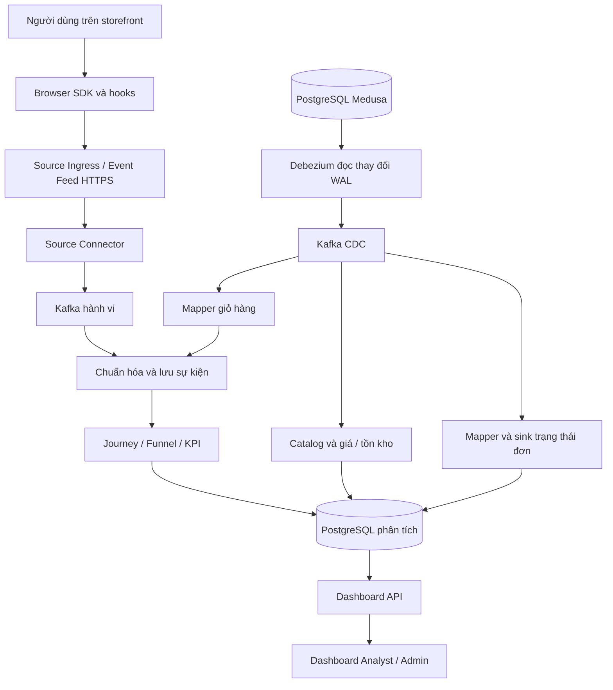

# Phân tích hệ thống Funnelmetry hiện tại

Ngày phân tích: **14/11/2026**.

Phạm vi: tài liệu hiện hành, mã nguồn local và bằng chứng kiểm thử đã thu trong phiên làm việc. Không thực hiện kiểm tra lại VPS trong lượt viết tài liệu này. Các nhận định về live là quan sát ở lần kiểm thử trước, không phải giám sát liên tục.

## 1. Kết luận chính

Funnelmetry hiện là một nền tảng thu thập và phân tích dữ liệu thương mại điện tử có nhiều thành phần: nhận hành vi trình duyệt, đọc thay đổi dữ liệu Medusa, xử lý sự kiện, lưu dữ liệu phân tích và cung cấp dashboard/API.

**Hệ thống đã có cấu trúc xử lý và các luồng đọc dữ liệu thực tế, nhưng mức độ kiểm chứng chưa đồng đều.** Dashboard Analyst đã truy cập được trong phiên kiểm thử. Tuy nhiên, chưa đủ bằng chứng xác nhận dữ liệu đầy đủ trên toàn tuyến, realtime đã đồng bộ, khả năng phục hồi và hiệu năng production.

Điểm cần ưu tiên hiện nay là **xác định độ tin cậy và độ tươi của dữ liệu theo đúng nguồn, phạm vi và loại chỉ số**. Tăng tốc một hàm hay làm dashboard đẹp hơn đều hữu ích, nhưng không giải quyết được việc thiếu bằng chứng đối soát.

## 2. Hệ thống đang giải quyết bài toán gì?

Hệ thống giúp trả lời những câu hỏi như:

- Người dùng đã xem sản phẩm, tìm kiếm và thực hiện những hành vi nào?
- Dữ liệu đã đi qua các bước của hành trình/phễu ra sao?
- Danh mục, giá và trạng thái đơn hàng hiện được nguồn Medusa ghi nhận thế nào?
- Dữ liệu phân tích có đang thiếu, chậm hoặc chưa được xác nhận không?

Không phải mọi câu hỏi đều dùng cùng một nguồn hoặc cùng cách đếm. Ví dụ, số sự kiện xem sản phẩm khác số phiên truy cập; số bản ghi đơn hàng khác số chuyển đổi; giá trị đơn đã đặt khác tiền đã thu.

## 3. Kiến trúc tổng thể

Sơ đồ rút gọn theo code/tài liệu; không xác nhận mọi thành phần đang khỏe tại thời điểm đọc.

### Đường 1: hành vi người dùng

Browser SDK gửi hành vi tới Source Ingress. Source Connector đọc Event Feed bằng HTTPS, đưa vào Kafka, sau đó các worker chuẩn hóa và xử lý.

Connector chỉ tiến con trỏ đọc sau khi bàn giao Kafka theo contract. Đây là cơ chế hỗ trợ tránh bỏ qua sự kiện khi gặp lỗi. Vì dữ liệu có thể được giao lại, downstream phải xử lý lặp mà không tạo tác động trùng. Có cơ chế trong code không đồng nghĩa đã nghiệm thu mọi tình huống mất mạng/crash trên live.

### Đường 2: thay đổi dữ liệu Medusa

CDC đọc nhật ký thay đổi của PostgreSQL, thay vì yêu cầu backend gửi từng sự kiện nghiệp vụ. Các mapper/writer biến thay đổi đó thành dữ liệu phân tích tương ứng.

**Điểm mạnh:** Có thể theo dõi thay đổi nguồn ở cấp database. **Đánh đổi:** Cần quản lý offset, replication slot, lịch sử WAL còn giữ được và snapshot. Nếu lịch sử đã mất, không thể chỉ tạo lại kết nối rồi tuyên bố đã khôi phục đầy đủ dữ liệu.

### Nơi lưu và cung cấp dữ liệu

PostgreSQL Pipeline chứa dữ liệu đã được tổ chức phục vụ phân tích, không phải bản sao đầy đủ mọi bảng Medusa. Dashboard API đọc dữ liệu này; giao diện gọi API để hiển thị.

Theo tài liệu hiện hành, triển khai Pipeline dùng Docker Swarm; Medusa và Source Ingress có deployment riêng. Profile single-node phù hợp phát triển/demo nhưng không tự chứng minh khả năng chịu lỗi khi cả máy chủ ngừng hoạt động.

## 4. Điểm quan trọng nhất: có nhiều loại dữ liệu khác nhau

| Loại | Dùng để hiểu điều gì? | Không được suy ra |
|---|---|---|
| Hành vi trình duyệt | Lượt xem, tìm kiếm, thao tác quan sát được | Giao dịch đã hoàn tất hoặc tiền đã thu |
| CDC giỏ hàng | Thay đổi giỏ đã lưu; sự kiện thêm giỏ theo mapping | Mỗi snapshot ban đầu là một lần thêm giỏ mới |
| CDC trạng thái đơn hiện tại | Đơn đang được ghi nhận theo contract current-state | Sự kiện `order.placed`, doanh thu hoặc chuyển đổi lịch sử |
| Phễu lịch sử `commerce-conversion@2.0.0` | Chuỗi bước kết thúc bằng `order.placed` theo profile lịch sử | Toàn bộ đơn CDC mới sẽ tự động được tính vào phễu này |
| Catalog/giá hiện tại | Danh mục và giá theo variant, currency, channel, region | Giá trị đơn hàng trong quá khứ |
| Dataset synthetic | Thử nghiệm, minh họa và đánh giá trên dữ liệu được tạo | Hoạt động kinh doanh thật |

**Hệ quả thực tế:** Dashboard phễu có ít dữ liệu trong khi CDC có nhiều đơn chưa chắc là lỗi đếm. Hai màn hình có thể đang đo hai đại lượng khác nhau. Phải đối chiếu contract và phạm vi trước khi sửa mapping hoặc cộng gộp số liệu.

## 5. Những chức năng hiện có và mức độ xác nhận

| Mảng | Bằng chứng hiện có | Nhận định |
|---|---|---|
| Đăng nhập Analyst, Overview, Funnel, Products, Events, Data Health | Đã đọc live ở phiên trước; các API GET ghi nhận không lỗi | Có bằng chứng đường đọc hoạt động trong phiên đó |
| Xử lý phễu | Có worker, test quy tắc và đối chiếu cũ/mới | Logic được kiểm tra trên những ca đã chạy; chưa bao phủ toàn hệ thống |
| Đối soát | API/code có gate; live trước đó báo snapshot/comparison 0/0 | Chưa đủ bằng chứng để chốt độ tin cậy trong scope đó |
| Admin | Có menu, route, quyền và module quan sát | Chưa kiểm thử Admin live trong đợt này |
| Realtime | Có SSE backend và cơ chế kiểm tra session/quyền trước khi gửi | Chưa xác nhận thông báo cập nhật phễu tới frontend và giữa replica |
| AI | Có trang `/ai`, iframe, thiết lập phiên và cấu hình URL DB-GPT | Có code tích hợp; chưa kiểm chứng phiên AI live trong đợt này |
| Phục hồi/autoscale | Có tài liệu, công cụ và màn hình theo capability | Chưa có thử nghiệm sự cố/tải mới để khẳng định hiệu quả |

### Vì sao các URL cũ chuyển về Tổng quan?

Code `App.tsx` hiện chủ động chuyển `/metrics`, `/assets`, `/workspace` về `/overview`, `/journeys` về `/funnels` và `/chat` về `/ai`. Các route không được khai báo đi qua fallback về trang gốc. Tài liệu UI cũng ghi đã rút các module chuyên sâu khỏi menu chính.

Vì vậy, chuyển hướng đã thấy trong kiểm thử không phải tự động là lỗi router. Tuy nhiên, hệ thống cần mô tả rõ chức năng nào đã gộp, chức năng nào chưa có để người dùng không tưởng mở URL là đã truy cập được tính năng tương ứng.

## 6. Phân tích độ tin cậy dữ liệu

### Điều đã xác định

API tính trạng thái đối soát theo các snapshot trong nguồn và khoảng `coverage_end_at` được chọn. Nếu không có snapshot, gate là `UNAVAILABLE`, lý do `NO_RECONCILIATION_EVIDENCE`.

Worker đối soát có CLI nhận snapshot/projection và yêu cầu so sánh; tài liệu không mô tả worker tự lấy dữ liệu Medusa. Như vậy, việc có worker chưa đảm bảo đã có đầu vào để đối soát.

### Điều chưa xác định

Chưa biết snapshot trên VPS chưa được nạp, có ngoài phạm vi ngày, hay việc nạp đã thất bại. Chưa có truy vấn database mới để phân biệt các trường hợp đó.

Trong phiên Analyst trước, phễu hiển thị 2 entrants, 2 converted và 2 provisional. Tỷ lệ 100% chỉ phản ánh 2/2 trong phạm vi đang xem. Không đủ để kết luận tỷ lệ kinh doanh ổn định hoặc dữ liệu đã được xác nhận đầy đủ.

### Tác động tới người sử dụng

Người dùng vẫn có thể khám phá dữ liệu, nhưng cần nhìn thấy nguồn, khoảng thời gian, loại dữ liệu và mức độ xác nhận. AI hoặc báo cáo dùng các số này cũng phải giữ các giới hạn đó, không đổi thành kết luận chắc chắn.

## 7. Phân tích code và hiệu năng

### Điểm đã cải thiện tại local

- Worker tính phễu chuyển đổi thời gian một lần mỗi sự kiện, dùng bảng tra bước và tập hợp sự kiện nhánh phụ thay vì quét lặp.
- API client truyền tín hiệu hủy tới `fetch` khi query không còn được dùng. Playwright xác nhận hủy yêu cầu phễu khi rời tab.
- Giao diện bổ sung retry, đồng bộ profile đang chọn và giải thích trạng thái đối soát.

Phép đo riêng hàm tính phễu với 10.000 sự kiện giả lập cho kết quả trung vị 71,44 → 6,37 ms. 200 ca đối chiếu cho kết quả giống code cũ. **Chưa thể quy mức tăng tốc này thành tốc độ toàn pipeline.** Code mới có thêm cấp phát bộ nhớ; chưa đo RAM cao nhất.

### Điểm chưa đo

Chưa có thời gian SQL thực tế, phân bố độ trễ toàn tuyến, tải Kafka, tốc độ cập nhật CDC và CPU/RAM trên VPS. Schema đã có index theo source/profile/version/entry_at, nên chưa có cơ sở thêm index tương tự.

Đã chuẩn bị `diagnose-funnel.mjs` dùng transaction chỉ đọc và `EXPLAIN ANALYZE`. Công cụ chưa được chạy với PostgreSQL trong đợt này; Docker daemon local không truy cập được ở lần thử trước.

### Bảo trì mã nguồn

Có cả component Friendly/chi tiết và component workspace đang được route sử dụng. Điều này làm việc sửa một hành vi dùng chung phải rà nhiều nơi. Đây là rủi ro bảo trì quan sát từ cấu trúc code, chưa phải kết luận mọi component cũ có thể xóa. Nên lập danh sách route/import đang dùng trước khi gom hoặc loại bỏ.

## 8. AI: cần tách ba phạm vi

1. **Dashboard Funnelmetry:** code hiện có `/ai`, xác thực phiên qua POST tới dịch vụ AI, iframe và kiểm tra origin/source của message. Chưa kiểm chứng cấu hình URL/session trên VPS trong lượt này.
2. **Tài liệu năng lực tổng quan:** vẫn mô tả DB-GPT/embedded Agent là giai đoạn sau. Điều này cho thấy tài liệu và code cần được đối chiếu lại theo phiên bản triển khai.
3. **`NCKH/AI_GENT`:** README xác định đây là prototype nghiên cứu riêng. Kết quả nghiên cứu không được tự coi là bằng chứng AI production của Funnelmetry. Không đánh giá lại benchmark nghiên cứu trong tài liệu này.

Việc cần làm là xác định chính xác phiên bản dịch vụ AI đang được triển khai, bộ công cụ được bật, dữ liệu mà nó đọc và kết quả kiểm thử phiên thực. Không dùng sự tồn tại của iframe để khẳng định Agent đã hoàn chỉnh.

## 9. Quyền truy cập và vận hành

Frontend có route guard theo permission, API có kiểm thử HTTP về auth/role; SSE kiểm tra tài khoản/session trước khi gửi dữ liệu và giới hạn hàng đợi. Đây là các cơ chế cụ thể có trong code.

Token frontend đang lưu trong localStorage. Cách này cần được đưa vào đánh giá bảo mật trình duyệt/XSS và quản lý session; chỉ đọc thấy cơ chế lưu token chưa đủ để kết luận tồn tại lỗ hổng khai thác.

Đợt này chưa thực hiện audit bảo mật toàn diện, kiểm thử xâm nhập, failover, restore backup hoặc tải lớn. Không suy “HTTP 200”, “container healthy” hoặc có trang Recovery thành chứng nhận toàn hệ thống an toàn và phục hồi được.

## 10. Đánh giá tổng hợp

| Điểm mạnh | Điểm còn yếu hoặc thiếu bằng chứng |
|---|---|
| Tách nguồn, ingestion, xử lý, lưu trữ và giao diện | Nhiều thành phần khiến chẩn đoán lỗi xuyên suốt phức tạp |
| Phân biệt contract, chất lượng và nguồn gốc số liệu | Người dùng dễ nhầm phễu lịch sử với đơn CDC hiện tại |
| Có kiểm thử logic, HTTP và trình duyệt | Chưa đủ kiểm thử tích hợp DB/live, phục hồi và tải |
| Có đường đọc dữ liệu thực trên Analyst | Sự sẵn sàng của UI chưa chứng minh dữ liệu đầy đủ |
| Có tối ưu CPU được đo trước/sau | Chưa biết nút thắt lớn nhất của toàn hệ thống |
| Có code tích hợp AI và tài liệu nghiên cứu | Trạng thái AI local/tài liệu/live chưa được đối chiếu đầy đủ |

Không chấm phần trăm hoàn thiện vì chưa có bộ tiêu chí và bằng chứng nghiệm thu toàn hệ thống. Nhận định phù hợp là **có nền tảng triển khai và kiểm thử từng phần; còn thiếu xác minh toàn tuyến và đồng bộ trạng thái phiên bản**.

## 11. Thứ tự hành động đề xuất

| Thứ tự | Làm gì? | Khi nào coi là có kết quả? |
|---|---|---|
| 1 | Chốt deployment đang chạy: image/version, module bật, nguồn/dataset | Có bảng local–live rõ ràng, không nhầm thay đổi chưa deploy |
| 2 | Điều tra snapshot đối soát theo nguồn và thời gian | Phân biệt thiếu toàn nguồn, lệch phạm vi hay tác vụ thất bại bằng dữ liệu thực |
| 3 | Kiểm tra một luồng có kiểm soát từ nguồn tới dữ liệu phân tích | Theo được dấu sự kiện, phát hiện điểm trễ/trùng/thiếu nếu có |
| 4 | Chạy SQL diagnostic trên DB phù hợp | Có execution plan và thời gian để chọn đúng truy vấn/index cần tối ưu |
| 5 | Xác minh realtime của read-model và reconnect | Frontend hội tụ về dữ liệu mới sau cập nhật/mất kết nối, kể cả nhiều replica |
| 6 | Nghiệm thu và triển khai các sửa đổi local | Kiểm thử tích hợp đạt và website thật phản ánh bản sửa |
| 7 | Đối chiếu AI và tài liệu theo phiên bản live | Có ca hỏi–tool–evidence thực tế, xác định rõ phạm vi nghiên cứu riêng |
## 12. Nguồn đối chiếu
- [Kiến trúc](SYSTEM.md), [dữ liệu và contract](DATA.md), [năng lực](CAPABILITIES.md), [vận hành](OPERATIONS.md).
- [Phạm vi UI](UI_REFRESH_IMPLEMENTATION.md), [route thực tế](../../apps/dashboard-web/src/app/App.tsx).
- [Code tính gate và truy vấn](../../apps/dashboard-api/src/lib/v2-analytics-repository.js), [reconciliation worker](../workers/reconciliation-worker/README.md).
- [Trang AI](../../apps/dashboard-web/src/features/ai/AiWorkspacePage.tsx), [AI handoff](../../apps/dashboard-web/src/lib/ai-handoff.ts), [prototype nghiên cứu](../../../NCKH/AI_GENT/README.md).
- [Kiểm thử live trước đó](FUNNEL_PLAYWRIGHT_ASSESSMENT_2026-11-14.md), [tối ưu worker](TOI_UU_CODE_FUNNEL_2026-11-14.md), [sửa tiếp và kiểm thử local](FUNNEL_FOLLOWUP_FIXES_2026-11-14.md).

Các số kiểm thử được dẫn theo từng đợt: local mới nhất 17 ca Playwright, 20 unit test frontend, 13 test API; worker 18 đạt và 2 integration test DB bỏ qua. Đây là các bộ kiểm thử khác nhau, không cộng thành số ca nghiệm thu end-to-end.

> Lưu trữ bằng chứng: ảnh PNG, log TXT và raw live audit được giữ local, không đưa lên Git; các liên kết tới chúng chỉ mở được trong workspace đã kiểm thử. Git giữ mã kiểm thử và các kết quả JSON được chọn. Trạng thái chưa commit/deploy trong nội dung là mốc lịch sử của báo cáo; xem báo cáo triển khai mới nhất khi có.

